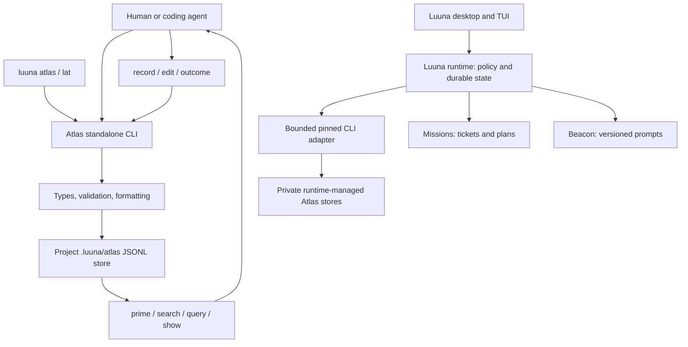
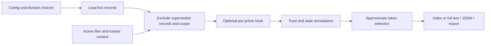
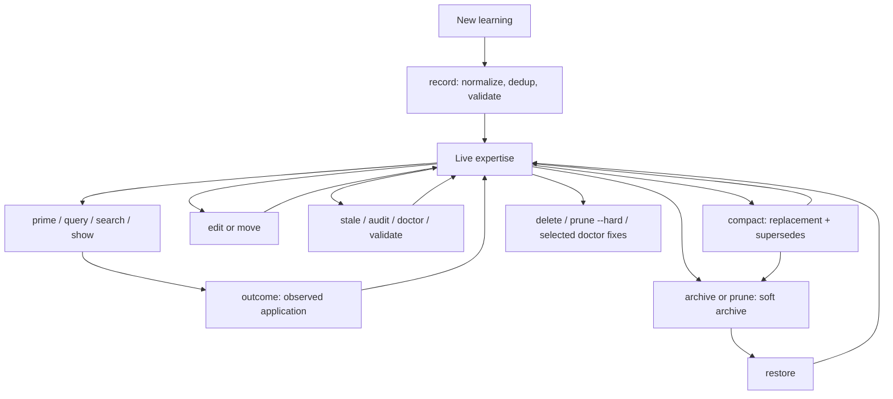

# Luuna Atlas: CLI, tooling, and system map

Compatibility baseline: `27477c313a3049b1579dfdc32c39da600726721f`, package `@luuna/atlas-cli` version `0.11.0`, Bun `1.4.3`. Mapped on October 22, 2026 before the Go rewrite. Command behavior, data contracts, workflows and ecosystem boundaries below define that baseline. The former implementation is preserved under `compat/reference/`; source links below point there. For the current native architecture, build instructions and rewrite verification, read [the Go rewrite report](GO-REWRITE-REPORT.md) and [README](README.md). The internal module and development-tool sections describe the former implementation, not the current production runtime. Historical plans and upstream instructions are identified separately.

Atlas stores reusable project knowledge and brings relevant knowledge back into a human or agent's working context. Its core is a local, Git-friendly collection of structured JSONL records, with deterministic retrieval, evidence links, outcome feedback, and maintenance commands. It does not need a model, embeddings server, database, account, or daemon for those operations.

The inventory covers **33 top-level commands** (32 visible and the hidden `update` compatibility command), **four `config` subcommands**, the TypeScript library, all source modules, setup recipes/hooks, repository scripts/CI, and current Luuna consumers. Every built-in command's exact options are captured in the companion [CLI reference](CLI-REFERENCE.md). Custom type configuration can add more flags at startup.

## Navigation

- [Role in Luuna and entry points](#role-in-luuna-and-entry-points)
- [A practical operating workflow](#a-practical-operating-workflow)
- [Complete command map](#complete-command-map)
- [Records, domains, and storage](#records-domains-and-storage)
- [Configuration and custom types](#configuration-and-custom-types)
- [How retrieval and context selection work](#how-retrieval-and-context-selection-work)
- [Record lifecycle and maintenance](#record-lifecycle-and-maintenance)
- [Agent setup, hooks, and recipes](#agent-setup-hooks-and-recipes)
- [TypeScript API and output contracts](#typescript-api-and-output-contracts)
- [Internal source map](#internal-source-map)
- [Development tools and validation](#development-tools-and-validation)
- [Luuna runtime and other consumers](#luuna-runtime-and-other-consumers)
- [Current limitations and documentation drift](#current-limitations-and-documentation-drift)
- [Verification and scope](#verification-and-scope)

## Role in Luuna and entry points

| Part | Responsibility | Typical contents |
|---|---|---|
| Atlas | Structured expertise and project memory | Conventions, patterns, failures, decisions, references, guides |
| Missions | Tickets, plans, dependencies, work status | What needs doing and how work relates |
| Beacon | Reusable versioned prompts | Instructions that can be reused across runs |
| Luuna runtime | Execution and policy authority | Approval, plan binding, scope, budgets, workers, review, durable orchestration, publication |
| Desktop/TUI | Interfaces to runtime operations | Search/select/correct memory; prepare and supervise work |

Atlas can run independently. Luuna can call it, but Atlas does not enforce Luuna's approval or publication rules. A record about a decision is knowledge; it is not itself an approved execution plan or a runtime authorization.



There are three distinct usage paths:

1. **Checkout:** `bun src/cli.ts <args>` from the Atlas source repository. To operate on a different project without installing launchers, run Bun with the absolute path to this repository's `src/cli.ts`, while your working directory is that project's root.
2. **Installed developer CLI:** `luuna-atlas <args>`, suite shortcut `lat <args>`, package compatibility alias `la <args>`, or `luuna atlas <args>`. The main Windows installer creates `luuna-atlas` and `lat`; it does not itself create `la`. The suite passthrough preserves the current project directory and does not start a runtime.
3. **Managed application:** desktop/TUI → HTTP runtime API → pinned component adapter → private runtime-managed store. This has different ownership and policy rules from direct developer CLI use.

The package is private/unpublished. Use source or Luuna's checkout installer, not a similarly named registry package. `upgrade` is deliberately disabled. Source: [README](README.md), [package metadata](package.json), [development rules](AGENTS.md), [upstream provenance](UPSTREAM.md).

On Windows, with the main Luuna and all three component repositories beside this checkout, install the suite launchers from the Atlas directory with:

```powershell
& ..\luuna\scripts\install-cli.ps1
```

The installer installs dependencies for all three components, creates launchers under `$env:LOCALAPPDATA\Luuna\bin` by default, and updates the user PATH. Open a new terminal afterward. `-ComponentsRoot` and `-InstallDirectory` support other checkout/install locations. This is an installation example; the map did not run the installer.

## A practical operating workflow

Examples below use installed `lat`. Substitute `luuna-atlas`, `luuna atlas`, or the checkout invocation as appropriate. Run in the intended project's root. These are usage examples, not actions performed by this mapping exercise. IDs shown are placeholders to replace with actual returned IDs.

### Set up a project once

```sh
lat init
lat add architecture
lat add testing
lat onboard --stdout
```

`init` creates configuration, an expertise directory and explanatory README, and adds the expertise union-merge rule to `.gitattributes`. `onboard --stdout` previews operating guidance. Use `lat onboard` to write it when wanted. Choose a provider with `lat setup --list`, then for example `lat setup claude` or `lat setup codex`; provider compatibility must still be checked in the actual agent application.

Do not initialize stores merely to work on Atlas itself. For this repository's development, use its existing source/tests and follow `AGENTS.md`. Do not write directly into Luuna runtime-owned stores.

### Start work by loading relevant knowledge

```sh
lat prime
lat prime architecture
lat prime --files src/payments/checkout.ts
lat search "retry timeout" --domain architecture
lat query testing --type failure
lat show mx-abc123
```

`prime` gives an index suited to agent context; `show` expands selected records. `search` answers a text question using lexical ranking; `query` lists/filter records without a text question. Scope by files/domain when the task is specific. Use `prime --full` when the full bodies are actually needed. `prime --manifest` gives a domain overview.

### Save a learning after verifying it

```sh
lat record architecture --type decision --title "Keep retry scheduling in the worker" --rationale "The worker owns cancellation and backoff state" --evidence-file src/worker/retries.ts
lat record testing --type failure --description "Parallel tests share a fixed temporary filename" --resolution "Create a unique directory for each test" --dir-anchor test --evidence-commit abc1234
lat record architecture --type convention --content "Avoid retrying non-idempotent writes because retries can duplicate effects" --dir-anchor src/payments
```

Choose a domain for a durable subject, rather than a new domain for every session. Capture the rule and reason or failure and resolution; reference the code or work that supports it. Default classification is `tactical`; use `--classification foundational` for knowledge intended to remain useful, and `observational` for observations. These are retention classes, not confidence or permission levels.

### Close the feedback loop

```sh
lat outcome testing mx-abc123 --status success --notes "Applied to the parallel fixture tests" --test-results "Targeted suite passed"
lat edit architecture mx-def456 --rationale "Updated reasoning after checking cancellation behavior"
lat ready --since 7d --limit 10
lat stale
lat audit --suggest
lat validate
```

Append outcomes only for actual applications. Successful and partial outcomes increase confirmation ranking. Re-check old knowledge before treating it as current. Correct it, replace it with `record ... --supersedes <id>`, or archive it when it no longer applies.

### Maintain and share deliberately

```sh
lat archive testing mx-abc123 --reason "Replaced by a shared fixture helper" --dry-run
lat prune --dry-run --check-anchors --explain
lat compact testing --analyze
lat diff --since HEAD
```

Review previews before applying maintenance. `archive` without `--dry-run` and `prune` without `--dry-run` mutate the store. `restore <id>` reverses a soft archive. `delete`, `delete-domain`, `prune --hard`, and parts of `doctor --fix` remove data.

The store is designed to travel through Git. Inspect the Git diff and include appropriate files in the project's normal review/commit workflow. `lat sync` performs a local Git commit; it does not push or perform network synchronization. It must be explicitly authorized where repository instructions restrict commits. **No `sync`, commit, or push was performed for this map.**

### Machine consumption and bulk import

```sh
lat --json --quiet search --domain architecture
lat --json --quiet prime --files src/payments/checkout.ts
lat record testing --batch records.json --dry-run
lat record testing --batch records.json
```

Batch input is a JSON object or array, not JSONL. Each record supplies its own type/payload; `classification` and `recorded_at` can be defaulted. Pre-create domains for stable machine output and to avoid dry-run auto-creation. Bulk operations can partially succeed, so inspect row-level results and exit status. They do not run all the convenience enrichment/quality behavior of the single-record path.

## Complete command map

Positional syntax below fills a gap in the custom help formatter, which displays generic usage and omits argument sections. Prefix every entry with `lat` or another entry point. Angle brackets are required arguments; square brackets are optional. The linked reference contains **every current built-in flag**, choices and help defaults.

### Initialization, configuration, integration

| Command | Purpose and notable controls | Effects / boundaries |
|---|---|---|
| [`init`](CLI-REFERENCE.md#init) | Initialize `.luuna/atlas` | Creates store/config/README/expertise and Git attributes; preserves existing config |
| [`add <domain>`](CLI-REFERENCE.md#add) | Declare a knowledge domain | Updates config, ensures JSONL file |
| [`config schema`](CLI-REFERENCE.md#config-schema) | Emit JSON Schema for configuration UIs | Raw JSON schema; no standard result envelope |
| [`config show`](CLI-REFERENCE.md#config-show) | Emit effective config; `--path <dot.path>` selects a knob | Raw JSON; single-path reads can fall back to schema defaults |
| [`config set <path> <value>`](CLI-REFERENCE.md#config-set) | YAML-parse value, validate resulting config | Locked atomic config replacement; rewrites YAML comments |
| [`config unset <path>`](CLI-REFERENCE.md#config-unset) | Remove optional setting; restore fallback | Idempotent; rejects removals violating required schema |
| [`onboard`](CLI-REFERENCE.md#onboard) | Add/update versioned instruction snippet; `--stdout`, `--check`, `--provider` | Automatically chooses guidance location; provider currently does not vary snippet |
| [`setup [provider]`](CLI-REFERENCE.md#setup) | Install/check/remove/list integration recipes; optional `--hooks` | Edits provider/project files; explicit `--hooks` edits `.git/hooks/pre-commit` |
| [`completions <shell>`](CLI-REFERENCE.md#completions) | Emit Bash, Zsh or Fish completion script | Prints shell code; current output binds `luuna-atlas` and `la`, not `lat` |
| [`upgrade`](CLI-REFERENCE.md#upgrade) | Future registry upgrade/check path | Fails while package remains private, including `--check` |
| [`update`](CLI-REFERENCE.md#update) | Hidden deprecated compatibility command | Exits 1 with guidance to use `upgrade`; does not forward or update anything |

`config` is a parent command; its four children are counted separately from the 33 top-level registrations.

### Recording and changing knowledge

| Command | Purpose and notable controls | Effects / boundaries |
|---|---|---|
| [`record <domain> [content]`](CLI-REFERENCE.md#record) | Create/upsert typed knowledge; `--type`, `--classification`, payload/evidence/link/outcome flags; `--batch`, `--stdin`, `--force`, `--dry-run` | Auto-creates missing domain; validates schema/domain; single path enriches evidence and checks quality; named duplicates can upsert |
| [`edit <domain> <id>`](CLI-REFERENCE.md#edit) | Change supported fields; classification, payload, files, links, appended outcome, dynamic custom fields | Locks/replaces domain file; preserves ID; not an interactive editor; not all record metadata has flags |
| [`outcome <domain> <id>`](CLI-REFERENCE.md#outcome) | No `--status`: inspect history. With `--status success\|failure\|partial`: append evidence of application | Supports duration, agent, notes, test-results; timestamps new outcomes |
| [`move <source-domain> <id> <target-domain>`](CLI-REFERENCE.md#move) | Move live record; `--dry-run`, `--force` | Preserves ID/metadata; both domains must exist; force bypasses target allowed-types, not required fields; not a multi-file transaction |
| [`archive <domain> [id]`](CLI-REFERENCE.md#archive) | Soft-archive one or comma-separated `--records`; mandatory `--reason`; `--dry-run` | Adds archive metadata, removes live entries |
| [`restore <id>`](CLI-REFERENCE.md#restore) | Restore archived record to its domain | Searches archives; strips archive metadata; refuses live-ID collision |
| [`delete <domain> [id]`](CLI-REFERENCE.md#delete) | Hard-delete one, `--records`, or `--all-except`; `--dry-run` | ID/full-hash/unique-prefix selection; no confirmation prompt and no positional row-index selector |
| [`delete-domain <domain>`](CLI-REFERENCE.md#delete-domain) | Remove configured domain/live expertise file; `--yes`, `--dry-run` | Confirmation normally required; distinct from archive retention |

`record` payload flags are `--content`, `--name`, `--description`, `--resolution`, `--title`, `--rationale`, `--files`. Anchors/tags/links use `--dir-anchor` (repeatable), `--tags`, `--relates-to`, `--supersedes`. Evidence flags are `--evidence-commit`, `--evidence-issue`, `--evidence-file`, `--evidence-bead`, `--evidence-missions`, `--evidence-gh`, `--evidence-linear`. Initial outcome flags are `--outcome-status`, `--outcome-duration`, `--outcome-test-results`, `--outcome-agent`.

Outside batch/stdin mode, `--type` is required. `--description` offers convenience filling for built-ins: convention content, derived named-type name, or decision title/rationale; failure still needs a resolution. Explicit payload flags take precedence. `--files` is a payload only for types that declare it; use `--dir-anchor` or evidence for other types. Schema fields `owner`, live `status`, and `evidence.date` do not each have corresponding built-in CLI flags.

### Reading, finding, and surfacing knowledge

| Command | Purpose and notable controls | Result |
|---|---|---|
| [`query [domain]`](CLI-REFERENCE.md#query) | Domain or `--all`; filter type/classification/file/outcome; `--sort-by-score`; five local formats | Matching live records grouped by domain; no text query; outcome choice excludes `partial` |
| [`search [query]`](CLI-REFERENCE.md#search) | Text and/or domain/type/tag/classification/file/outcome filters; `--archived`, `--no-boost`, `--sort-by-score`, formats | BM25 text ranking, with optional confirmation boost; filter-only queries supported |
| [`prime [domains...]`](CLI-REFERENCE.md#prime) | Agent-context index; `--full`, `--compact`, `--manifest`; domain inclusion/exclusion, `--files`, `--context`, `--all`, `--budget`, `--no-limit`, `--records-only`, `--dry-run`, `--export` | Context selected for the task; human text default; JSON/dry-run modes have different budgeting behavior |
| [`show <ids...>`](CLI-REFERENCE.md#show) | Expand record IDs/prefixes across live domains | Full bodies plus metadata; fails ambiguous selection |
| [`rank [domain]`](CLI-REFERENCE.md#rank) | Rank by confirmation count; `--type`, `--limit` (10), `--min-score` (0) | Outcome-derived score and record details |
| [`ready`](CLI-REFERENCE.md#ready) | Recent records; `--limit` (10), `--domain`, `--since 24h\|7d\|2w` | Sorts by `recorded_at`; does not list ready Missions tickets |
| [`stale [domains...]`](CLI-REFERENCE.md#stale) | Advisory stale-record inspection | Missing anchors, substantial Git churn, or unconfirmed expired shelf life |
| [`learn`](CLI-REFERENCE.md#learn) | Inspect changed files; `--since` (HEAD~1) | Suggests domains from existing file anchors; does not write a learning or call an LLM |
| [`diff`](CLI-REFERENCE.md#diff) | Record additions/removals since `--since` (HEAD~1) | Reads Git diff of live expertise; includes changes since ref, not just unstaged changes |
| [`hook`](CLI-REFERENCE.md#hook) | Claude PreToolUse stdin handler | File-context injection and best-effort hand-edit guard; can write ignored session/usage state |

### Health, retention, and Git

| Command | Purpose and notable controls | Effects / boundaries |
|---|---|---|
| [`status`](CLI-REFERENCE.md#status) | Domain/type/classification counts, age/governance health | Read/report |
| [`validate`](CLI-REFERENCE.md#validate) | Check live JSONL against record schemas/domain rules; legacy outcome warnings | Nonzero on violations; bypass flags have deliberately limited scope |
| [`doctor`](CLI-REFERENCE.md#doctor) | Detailed health checks; `--fix` | Default diagnoses; fixes can remove invalid and stale rows, normalize outcomes/anchors, repair domain files/config |
| [`audit`](CLI-REFERENCE.md#audit) | Corpus evidence, rule density, floaters, mix; `--suggest`, `--domain`, `--ignore-domains`, `--ci` | Read/report; `--ci` emits JSON and fails on FAIL-band signals |
| [`prune`](CLI-REFERENCE.md#prune) | Retention/supersession; `--dry-run`, `--hard`, `--aggressive`, `--check-anchors`, `--explain` | Default soft archive; can demote superseded/anchor-decayed tiers; hard deletion optional |
| [`compact [domain]`](CLI-REFERENCE.md#compact) | `--analyze`, manual `--apply`, or `--auto`; auto preview/limits/confirmation; replacement payload flags | Consolidates records and archives originals; mechanical default, optional summarizer hook |
| [`sync`](CLI-REFERENCE.md#sync) | Validate, stage `.luuna/atlas`, local commit; `--message`, `--no-validate` | Git commit, no push; skips worktree commits; also commits any unrelated files already staged |

All command handlers are in [src/commands](compat/reference/src/commands); registration and global handling are in [src/cli.ts](compat/reference/src/cli.ts).

## Records, domains, and storage

### Store layout

```text
<project>/
  .gitattributes                         # expertise JSONL merge=union
  .luuna/atlas/
    config.yaml                          # domain registry and settings
    README.md                            # generated explanation
    expertise/<domain>.jsonl              # live knowledge, one JSON object per line
    archive/<domain>.jsonl                # soft archives with comment banner
    recipes/<name>.ts or <name>.sh        # optional project integration code
    hooks/                               # conventional location for configured scripts
    state/.gitignore                     # ignores hook state
    state/sessions/<session-id>.txt       # IDs injected in that session
    state/usage.jsonl                     # passive injection usage log
```

Locks (`.jsonl.lock`) and rewrite temps (`.jsonl.tmp.<random>`) are transient. Treat config, knowledge and intentionally shared hooks/recipes as team assets; treat generated session state as local. Review content before publishing a store: record bodies and configured scripts are not automatically secret-scrubbed.

Store lookup is based on the supplied/current directory, with special Git worktree resolution; the normal config helper does not search every ancestor for an arbitrary Atlas config. Run from the intended project root. A linked worktree uses the main checkout's store when that store exists. `sync` then skips the commit from the worktree. This reduces competing copies but means branch/worktree isolation does not imply an isolated Atlas store.

Domain names match `^[a-zA-Z0-9][a-zA-Z0-9_-]*$`. Each config domain maps to a live expertise file. A domain is a grouping label, not a filesystem capability or permission scope.

### Built-in records

Every live record requires `type`, `classification`, and `recorded_at`, plus its type's payload. The runtime registry compiles schemas with `additionalProperties: false`.

| Type | Intended use | Required payload | Optional payload | Dedup/ID key |
|---|---|---|---|---|
| `convention` | Rule and reason to follow | `content` | — | `content` |
| `pattern` | Reusable implementation approach | `name`, `description` | `files[]` | `name` |
| `failure` | Pitfall and demonstrated resolution | `description`, `resolution` | — | `description` |
| `decision` | Chosen approach and rationale | `title`, `rationale` | `date` | `title` |
| `reference` | Resource or code location worth finding | `name`, `description` | `files[]` | `name` |
| `guide` | Procedure or explanation | `name`, `description` | — | `name` |

Common optional fields:

| Field | Shape / meaning |
|---|---|
| `id` | `mx-` plus 4–8 lowercase hex in schema; generator currently emits 6 |
| `evidence` | Optional strings: `commit`, `date`, `issue`, `file`, `bead`, `missions`, `gh`, `linear`; legacy Missions key remains readable |
| `tags` | String array |
| `relates_to`, `supersedes` | Record-ID arrays; schema permits domain-qualified strings, but current supersession matching requires bare full IDs |
| `outcomes` | Application history; status `success`, `failure`, `partial`; optional duration/test_results/agent/notes/recorded_at |
| `dir_anchors` | Repo-relative directories the record applies to |
| `owner` | Opaque string handle; schema support without a shipped automatic owner resolver |
| `status` | Optional live `draft`, `active`, `deprecated`; not Luuna runtime task status |
| `supersession_demoted_at`, `anchor_decay_demoted_at` | Decay progression timestamps |

Archive records add `status: archived`, `archived_at`, and `archive_reason`; these are outside live AJV schemas. Archive reasons include stale, superseded, anchor_decay, manual, and compacted, with explanatory text permitted.

### IDs, duplicates, and writes

IDs are deterministic SHA-256 prefixes of type and the raw ID-key value. The domain is excluded, so equal named records across domains can share an ID. Use domain-aware operations where possible; cross-domain `show`/`restore` may need an unambiguous selector. Dedup normalizes case, punctuation and whitespace within a type. This is deterministic key comparison, not general semantic understanding.

Named built-ins can upsert by key. The current single-record CLI rejects exact convention/failure duplicates even with `--force`; bulk and library paths have different force/skip behavior. Single-record named upsert preserves/merges old outcome history; the library replaces the record. IDs persist through edit/move rather than changing whenever text changes.

Expertise rewrites use random temp files and rename. Cooperating command/API writers use per-file advisory locks: retry every 50 ms, timeout 5 seconds, age-based stale-lock removal after 30 seconds. Windows replacement retries transient EPERM/EACCES/EBUSY up to 20 attempts. Append helpers do not acquire locks by themselves. Multi-file archive/move/compaction are not database transactions; union Git merges are not a substitute for validating duplicates and schemas after merging.

The JSONL reader skips blank/comment lines, normalizes legacy singular `outcome` and custom field aliases in memory, and rejects unknown types unless tolerated. It does not fully validate each read record. Malformed JSON reports file/line; initial file-read errors currently return an empty array even for errors other than missing files. Read/validate/diagnose are different guarantees.

### Legacy layout

The only one-way layout migration is [legacy-layout.ts](compat/reference/src/utils/legacy-layout.ts): `.mulch/` → `.luuna/atlas/`, with `mulch.config.yaml` → `config.yaml`. It preserves record shapes, updates matching leading Git attribute/ignore paths, and emits a stderr notice. It refuses conflicting old/new stores and specified symlink cases. Because lookup invokes migration, a read-looking command can trigger it. Old Missions layout has a read-only fallback. Old upstream executable names are not current installed aliases. Details: [MIGRATION.md](MIGRATION.md).

## Configuration and custom types

Use `config schema` for machine-consumable metadata, `config show` to inspect, and `config set/unset` for schema-checked atomic changes. Values are YAML-parsed, so numbers, booleans, arrays and objects work. Quote complex values for your shell.

```sh
lat config show --path search.boost_factor
lat config set search.boost_factor 0.2
lat config set prime.default_mode manifest
lat config set quality.level error
lat config unset search.boost_factor
```

The tolerant reader normalizes old domain arrays and fills governance/shelf-life defaults. It does not validate every config read against the complete public schema. `config show` for the whole object does not materialize all optional runtime defaults; `show --path` can obtain schema defaults. Programmatic domain add/remove uses a simpler direct YAML write, unlike the locked atomic `config set/unset` path. Serialization removes comments.

| Setting | Effective default / role |
|---|---|
| `version` | `"1"` in initialized configuration |
| `domains` | `{}`; domain → optional `allowed_types[]`, `required_fields[]` |
| `domains.<name>.allowed_types` | Missing/empty: all registered types |
| `domains.<name>.required_fields` | Missing/empty: no extra top-level requirements |
| `governance.max_entries` | 100, soft utilization target |
| `governance.warn_entries` | 150, diagnostic/display threshold |
| `governance.hard_limit` | 200, diagnostic/display threshold; not enforced by `record` as a write cap |
| `classification_defaults.shelf_life.tactical` | 14 days |
| `classification_defaults.shelf_life.observational` | 30 days; foundational has no age expiry |
| `prime.default_mode` | `full`: budgeted record index; alternative `manifest`. CLI `--full` separately selects full Markdown bodies |
| `prime.tier_weights.star` | 100 per confirmation score |
| `prime.tier_weights.foundational/tactical/observational` | 50 / 20 / 10 |
| `prime.session_close.style` | `conditional`; also directive/minimal/none |
| `prime.session_close.custom` | Optional verbatim footer; overrides style |
| `search.boost_factor` | 0.1; zero disables confirmation boost |
| `custom_types` | Optional additional type definitions |
| `disabled_types` | Optional deprecation list; warns on writes, still reads/registers |
| `decay.anchor_validity.threshold` | 0.5 valid fraction |
| `decay.anchor_validity.grace_days` | 7 days |
| `decay.anchor_validity.weight` | Reserved; no current ranking/fitness effect |
| `audit.thresholds` | Global metric thresholds, below |
| `audit.ignore_domains` | Optional excluded domain names |
| `audit.per_domain.<name>` | Partial overrides over global thresholds |
| `quality.level` | `warn`; also error/off. Near-duplicate blocking has stronger behavior than this name suggests |
| `hooks` | Ordered command arrays for pre-record/post-record/pre-prime/pre-prune/pre-compact |
| `hook_settings.timeout_ms` | 5000 per hook |

Audit defaults: evidence coverage PASS ≥0.5 / WARN ≥0.3; floater fraction PASS ≤0.2 / WARN ≤0.4; rule density PASS ≥0.25 / WARN ≥0.15. `max_records_per_domain` is 200 and `max_stale` is 0; those count overages produce warnings rather than automatic FAIL. Per-domain overrides merge over global/default values.

### Custom type definition

```yaml
custom_types:
  release_decision:
    extends: decision
    required: [release_tag]
    optional: [rollback_plan]
    dedup_key: title
    summary: "{title} ({release_tag})"
    section_title: Release decisions
    aliases:
      release_tag: [old_release_name]
```

This adds inherited title/rationale plus a required `release_tag`. CLI registration produces a `--release-tag` flag and optional `--rollback-plan` flag for `record`/`edit`. For example:

```sh
lat record releases --type release_decision --title "Cut the maintenance release" --rationale "The regression fix is verified" --release-tag v2.4.0
```

Custom keys: `extends`, `required`, `optional`, `dedup_key`, `id_key`, `summary`, `extracts_files`, `files_field`, `compact`, `section_title`, `aliases`.

- Extend a built-in only; custom-from-custom is unsupported. Built-in names cannot be shadowed. Required/optional fields merge parent-first, and required child fields can promote optional parent fields.
- Direct custom types need nonempty required fields, a dedup key and summary. Payload fields are strings, except a declared extracted file field becomes a string array. Names start with a lowercase letter and use lowercase letters/digits/underscores.
- Summary templates accept `{field}` or `{{field}}`; tokens must name declared fields.
- Aliases normalize legacy names to canonical fields on read. A populated canonical value wins; normalization persists only after a later write.
- Compaction strategies are `concat`, `merge_outcomes`, `keep_latest`, `manual`; a direct custom type defaults to manual.
- Deprecated types remain accepted with warnings. Unknown disabled names or extending a disabled parent fail registry initialization.
- **Current gaps:** arbitrary custom prose is not indexed by BM25, and `content_hash` used as the effective ID key currently generates collisions rather than hashing the record body. Use a real declared stable key and verify custom-type behavior before relying on it.

Source: [config types/defaults](compat/reference/src/schemas/config.ts), [config JSON Schema](compat/reference/src/schemas/config-schema.ts), [custom registry construction](compat/reference/src/registry/custom.ts), [config commands](compat/reference/src/commands/config.ts).

## How retrieval and context selection work

### Query, search, prime, show

| Operation | Selection | Ranking/budget | Best use |
|---|---|---|---|
| `query` | Domain/all plus structured filters | Insertion order or confirmation sorting; no context budget | Inspect a known subject or enumerate records |
| `search` | Text tokens and/or filters; archives opt-in | BM25 plus optional confirmation boost | Find knowledge matching a question |
| `prime` | Domains, paths, active work, supersession filtering | Index, trust ordering, approximate budget, stale annotations | Load task-relevant agent context |
| `show` | IDs/prefixes across live domains | Full expansion, no prime budget | Read the details behind an index line |

Search uses local BM25 (`k1=1.5`, `b=0.75`) with lowercase tokenization and punctuation removal, retaining hyphens. The searchable text is the six built-in payload shapes, built-in files and tags. Evidence, outcome notes and directory anchors are not full-text indexed; custom payload prose is currently omitted. File filtering in query/search is case-insensitive substring matching on a literal `files` array, unlike prime's path-aware matching.

Confirmation score = successful outcomes + 0.5 × partial outcomes. Failures contribute zero rather than subtracting. Search boost = `BM25 × (1 + boost_factor × confirmation_score)`. `--no-boost` gives plain BM25; `--sort-by-score` requests confirmation ordering instead. Search JSON remains domain-grouped, so consumers should not assume one globally sorted flat hit array.

### Prime selection pipeline



Default text output is a compact one-line index, including IDs, summaries, anchors, confirmation stars and stale hints, with an operating contract/footer. Explicit why-surfaced annotations appear in Markdown/plain/XML renderers, not the default compact lines. `--full` selects full Markdown bodies; an explicit global `--format` takes precedence and supports markdown/compact/xml/plain. `--records-only` removes surrounding operating prose. `--manifest` is a domain/count overview, not record details; it cannot combine with scope arguments, `--full`, or `--dry-run`.

When unscoped, text prime can use active Git working files and tracker references; `--all` opts out of auto-context scope. `--files` explicitly scopes paths. `--context` uses changed files since HEAD~1 plus staged/unstaged changes, rather than the active-files path; it requires Git. File anchors match exact/path-segment suffix relationships; directory anchors match containment. Unanchored records remain broadly relevant. Active-files detection includes untracked nonignored files and rename destinations.

Tracker context can come from local in-progress Missions/Bead issues, GitHub CLI PR lookup, and branch-name patterns for Missions/GitHub/Linear/Bead. Multiple candidates generate warnings. Explicit evidence flags select citations when recording. These are evidence/context helpers, not ticket lifecycle management or general remote tracker synchronization. GitHub CLI lookup can contact GitHub; core record search needs no service.

Trust ordering keeps failures first, then uses confirmations × star weight plus classification weight. Why-surfaced reasons prefer file match, then active tracker, then confirmations, recent authorship (<7 days), then broad application. Staleness annotations can mark missing/changed anchors; age-only staleness does not demote prime's display in the same way.

The default budget is **4000 estimated tokens**, using `ceil(characters/4)`, not a model tokenizer. Selection prioritizes matching anchors/failures, freshness, confirmations, classification and recency. Failures matching explicit `--files`/`--context` scope are pinned even when the budget is exceeded; automatic active-file scoping does not provide that budget-pinning predicate. Wrapper text and estimates also prevent treating the number as a strict request-size cap.

`prime --json` is a structured corpus view: it disables ordinary token budgeting and automatic context scoping. Explicit filters still matter. `prime --dry-run` emits a JSON record-selection summary, respects normal budget unless global JSON disabled it, and skips pre-prime hooks. Do not use `--json` as a synonym for identical text selection in a different encoding.

Source: [prime handler](compat/reference/src/commands/prime.ts), [budget](compat/reference/src/utils/budget.ts), [BM25](compat/reference/src/utils/bm25.ts), [trust ranking](compat/reference/src/utils/prime-ranking.ts), [Git context](compat/reference/src/utils/git.ts), [active work](compat/reference/src/utils/active-work.ts).

## Record lifecycle and maintenance



### Quality checks when writing

The single-record CLI does deterministic checks: a BM25 shortlist of 10 candidates plus token-set Jaccard finds near duplicates (≥0.6, or ≥0.45 with shared anchors). Superseded target records are exempted from that duplicate check. Convention/pattern grounding expects an anchor, issue/tracker citation, or explicit commit; automatically adding HEAD alone does not establish meaningful grounding. Convention prose is checked for a rule signal such as because/avoid/never/prefer.

`quality.level` defaults to warn, but current near-duplicate detection blocks unless forced whenever quality is enabled; warn does not mean every quality issue always writes. `--force` overrides near-duplicate and soft quality checks, but does not bypass exact anonymous-record rejection in the single-record CLI. Schema/domain validity and executable lifecycle hooks are separate checks. Batch/API paths have different coverage; do not infer all gates apply everywhere.

### Retention and supersession

Time expiry uses floor(age in days): tactical is stale when **older than** 14 days, observational older than 30, foundational never expires purely by age. Configuration can change those thresholds. `stale` additionally identifies missing anchors and at least five commits touching anchors since an evidence commit. Git failures fall back to local/age signals.

`prune` soft-archives age-expired records by default. Superseded records walk foundational → tactical → observational → archive, one tier per applicable pass; `--aggressive` collapses supersession straight to archive. Bare-ID links are collected across domains; self-links are ignored and multi-record cycles are excluded from demotion. Schema-permitted `domain:mx-id` strings are not resolved to bare IDs by this logic, so use bare full IDs for functioning supersession/hiding. `--check-anchors` adds anchor-validity decay below the threshold after the grace period. Records with zero anchors are exempt from anchor-ratio decay. A reserved weight setting does not implement a blended fitness score.

Use `prune --dry-run --check-anchors --explain` to inspect decisions. `--hard` permanently deletes eligible stale records rather than preserving the archive. Age expiry, advisory Git staleness, supersession and broken-anchor decay are related but distinct signals.

### Compaction

`compact --analyze` identifies groups; manual `--apply --records <comma-separated-ids>` requires at least two source IDs and replacement payload. `--auto` defaults to minimum group 5 and maximum 50 records, with `--dry-run` and `--yes` controls. The replacement is foundational and links to its sources through `supersedes`; sources are archived.

Built-ins default to mechanical concatenation strategies. Custom strategies can merge outcomes, keep latest, or require manual replacement. An optional pre-compact hook can provide semantic summarization; Atlas does not inherently send the corpus to a model. `--dry-run` applies to auto mode, not manual `--apply`.

### Health tools measure different things

- `validate`: schema and domain conformance of live data.
- `doctor`: 17 check results across config, JSONL integrity, legacy outcomes, schema/unknown/custom types, domain compatibility/conformance/violations, age staleness, orphan domains, duplicates, file anchors, governance, decay, compaction summarizer, upgrade status.
- `audit`: corpus usefulness heuristics. Evidence coverage counts tracker/commit support, not merely an evidence file. A floater lacks tracker/commit/record relationship; a file anchor alone does not prevent floater status. Rule density inspects convention prose. Failure/decision mix helps identify weak domains.
- `status`: compact counts, utilization and age overview.

Only Missions citations currently resolve against a local issue index in audit. GitHub/Linear/Bead citation status is not fetched from those services. `doctor --fix` can discard malformed/schema-invalid rows and age-stale records, normalize old outcomes, remove broken anchors, and repair domain declarations/files. It reports the checks computed **before** fixes; run `doctor` again to assess the result. There is no current `doctor --strict` option.

Source: [record](compat/reference/src/commands/record.ts), [quality](compat/reference/src/utils/record-quality.ts), [prune](compat/reference/src/commands/prune.ts), [archive helpers](compat/reference/src/utils/archive.ts), [staleness](compat/reference/src/utils/staleness.ts), [doctor](compat/reference/src/commands/doctor.ts), [audit metrics](compat/reference/src/utils/audit.ts).

## Agent setup, hooks, and recipes

### Provider setup and onboarding

There are **three built-in recipes**: Claude, Cursor, Codex. Additional providers require discovered project/package recipes; older documents listing six built-ins are historical.

| Recipe | Managed integration |
|---|---|
| `setup claude` | Merges owned handlers into `.claude/settings.json`; SessionStart runs prime, PreToolUse runs hook for Read/Edit/Write/MultiEdit/NotebookEdit/Bash |
| `setup cursor` | Writes always-applied `.cursor/rules/luuna-atlas.mdc` |
| `setup codex` | Adds managed prose in `AGENTS.md` and marker-managed SessionStart TOML in `.codex/config.toml` |

`setup` requires an initialized Atlas store. `--check` verifies owned artifacts and takes precedence over `--remove`; `--remove` removes owned integration. `--list` explains discovery/shadowing. `--hooks` is a separate explicit project Git pre-commit validation hook; it assumes `.git/hooks` rather than implementing arbitrary core.hooksPath/worktree hook resolution. Dependency installation itself does not install hooks or change root hook configuration.

Generated Codex files establish what this source attempts to install; they do not prove a particular Codex build supports that hook configuration. The append-based TOML update is not a general TOML merger. Provider-native injection was not exercised in this mapping task.

`onboard` writes marker-managed operating instructions. It reuses existing snippet locations, otherwise prefers root CLAUDE.md, then AGENTS.md, otherwise creates CLAUDE.md; existing `.claude/CLAUDE.md` snippets are discoverable. `--stdout` previews and `--check` checks snippet version. There is no CLI flag to select an arbitrary target file. The current `--provider` flag does not change the standard snippet.

### Two different hook systems

**Provider hook command:** `lat hook` consumes Claude PreToolUse JSON. It can deny recognized hand edits to live expertise JSONL and inject file-anchored knowledge as additional context. It deliberately catches errors and fails open/silent. Shell-write detection is best effort, not a security sandbox or Luuna policy authority.

Injection is approximately 500 estimated tokens, failures first, stale last, excludes superseded/already-seen IDs and the Atlas store itself. Ignored session state prevents duplicate injection; session files expire after seven days. `usage.jsonl` records passive injection events and is not itself a learning store. Do not load it as project knowledge.

**Configured lifecycle hooks:** project config can run ordered external commands around Atlas operations:

| Event | Can block? | Can modify payload through JSON stdout? |
|---|---|---|
| `pre-record` | Yes | Yes, candidate record |
| `post-record` | Warn only after failure | No |
| `pre-prime` | Yes | Yes, selected domain/record payload |
| `pre-prune` | Yes | No, allow/block candidates only |
| `pre-compact` | Yes | Yes, replacement/summarization payload |

Hooks receive `{event, payload}` on stdin, run at project root with inherited environment plus `LUUNA_ATLAS_HOOK=1`, and default to 5-second deadlines. Mutable outputs accept the supported wrapped or bare payload. Scripts execute with local user capability; they may contact external systems if configured. Timeout/child cleanup has platform-specific handling; this is not an isolation boundary. Record/prune previews skip lifecycle hooks; prime's preview skips pre-prime.

### Recipe discovery

Precedence is project `.luuna/atlas/recipes/<name>.ts`, then `.sh`, then installed `luuna-atlas-recipe-<name>` npm package, then built-in. Project recipes can shadow built-ins. TypeScript/package recipes export install/check/remove functions; shell recipes receive the action and `LUUNA_ATLAS_RECIPE_NAME`/`LUUNA_ATLAS_RECIPE_ACTION`, with project cwd and inherited environment. Windows shell recipes require `sh`.

Examples: [internal-ide.ts](examples/recipes/internal-ide.ts), [legacy-bot.sh](examples/recipes/legacy-bot.sh). These are templates, not enabled services. Completion output supports Bash/Zsh/Fish, top-level commands and some global flags; nested/config/domain/type-aware completion and PowerShell completion are not implemented.

Source: [setup](compat/reference/src/commands/setup.ts), [onboard](compat/reference/src/commands/onboard.ts), [provider hooks](compat/reference/src/utils/claude-hooks.ts), [guard](compat/reference/src/utils/hook-guard.ts), [injection](compat/reference/src/utils/hook-inject.ts), [lifecycle executor](compat/reference/src/utils/hooks.ts), [recipe discovery](compat/reference/src/utils/recipe-discovery.ts).

## TypeScript API and output contracts

### Public library

The package main is [src/index.ts](compat/reference/src/index.ts), importing Bun-executed TypeScript. It is not an independently built Node distribution. Public functions:

| API | Behavior |
|---|---|
| `recordExpertise(domain, record, {force?, cwd?})` | Requires existing domain; locked create/upsert/skip result |
| `searchExpertise(query, options)` | Filters and BM25 per-domain matches; no CLI configured confirmation boost |
| `queryDomain(domain, options)` | Read domain with type/classification/file filters |
| `editRecord(domain, id, updates, {cwd?})` | Locked supported built-in/common field updates |
| `appendOutcome(domain, id, outcome, {cwd?})` | Append/timestamp outcome; returns record/outcome/count |

Exports also include API option/result/update types; record/config/evidence/outcome types; configSchema/recordSchema/DEFAULT_CONFIG; config path/read helpers; low-level read/write/append/dedup/ID/search helpers; confirmation count/rate/boost/sort helpers. `RecordType` is widened to string, while the exported `ExpertiseRecord` TypeScript union still enumerates six built-ins.

The library is **not equivalent to invoking the CLI**. It does not automatically initialize custom configuration registry or reproduce schema/domain/quality/hooks/evidence convenience gates. Named upserts replace the supplied record instead of preserving the CLI's outcome history behavior. Low-level write/append exports require caller-owned validation and locking. Consumers needing the CLI contract should use its process boundary deliberately.

### Global CLI options

| Option | Meaning |
|---|---|
| `-v`, `--version` | Version; with `--json`, emits name/version/runtime/platform |
| `--json` | Command-specific structured output, with exceptions below |
| `-q`, `--quiet` | Suppress ordinary non-error chatter where handlers honor it |
| `--verbose` | More details in handlers/formatters that use it |
| `--timing` | Elapsed dispatch timing to stderr; measurement starts after registry initialization |
| `--allow-unknown-types` | Tolerate unregistered on-disk types for lagging config/worktrees |
| `--allow-domain-mismatch` | Narrow bypass for record/validate; sync intentionally does not honor it |
| `--format markdown\|compact\|xml\|plain` | Rendering for prime/query/search; local query/search also accept `ids` |
| `-h`, `--help` | Help; hidden update still has direct help |

Typical command success writes `{success, command, ...data}` to stdout; shared command errors write `{success:false, command, error}` to stderr and set nonzero exit. Config/schema/version/completions/hook have specialized output contracts. Commander parser errors can remain text. Some validation failures return JSON on stdout. Treat exit status, stdout and stderr separately.

Known parsing hazards: `record --json` can print domain auto-creation text before JSON unless quiet; setup combining provider plus Git hooks can print two JSON objects; lifecycle hook stderr is forwarded; `--timing` adds stderr text. Use pre-created domains and `--quiet`, and implement command-specific parsing. The main runtime adapter does so rather than assuming a universal stdout shape.

Diagnostics use Pino on stderr, separated from product output. `LUUNA_ATLAS_LOG_LEVEL` overrides `LUUNA_ATLAS_DEBUG`; `LUUNA_ATLAS_LOG_JSON=1` selects JSON logs instead of an available TTY pretty transport. Common named credential keys are removed from structured logs; URL redaction strips userinfo. This is limited diagnostic redaction, not a universal secret detector for record bodies, hook stderr, arbitrary environment names or external recipes. No provider credential is required by Atlas core.

Source: [API](compat/reference/src/api.ts), [exports](compat/reference/src/index.ts), [JSON helpers](compat/reference/src/utils/json-output.ts), [logger](compat/reference/src/log.ts), [environment example](.env.example).

## Internal source map

Dispatch flow is `src/cli.ts` → `register*Command` → command action → shared registry/config/storage/retrieval/output utilities. There is no background service entry point. Package executable aliases all point to `src/cli.ts`.

| Source area | Modules and responsibilities |
|---|---|
| `src/cli.ts` | Registry startup, early/global flags, 33 registrations, version/JSON, custom help, typo suggestions, dispatch timing |
| `src/api.ts`, `src/index.ts` | Programmatic operations and public exports |
| `src/log.ts` | Diagnostic Pino construction, redaction, optional pretty output |
| `src/commands/*.ts` | One module per top-level command; complete command tables above |
| `src/schemas/config.ts`, `config-schema.ts` | Config TypeScript shapes/default constants and public JSON Schema |
| `src/schemas/record.ts`, `record-schema.ts`, `index.ts` | Record types, exported schema and schema barrel |
| `src/registry/builtins.ts` | Six built-in type schemas, summaries/renderers, key/file/compaction metadata |
| `src/registry/custom.ts`, `template.ts` | Build custom definitions, inherited fields and safe summary interpolation |
| `src/registry/type-registry.ts`, `init.ts` | Current registry, AJV validators, disabled/custom type initialization |
| `utils/config.ts`, `legacy-layout.ts` | Paths, domains, tolerant config/defaults/init, worktree mapping, one-way legacy layout |
| `utils/expertise.ts` | JSONL reading/writing, legacy normalization, IDs, dedup, record filtering and age checks |
| `utils/archive.ts`, `lock.ts`, `fs-rename.ts` | Soft archive/restore primitives, exclusive lockfiles, replacement retry |
| `utils/bm25.ts`, `scoring.ts`, `budget.ts`, `prime-ranking.ts` | Lexical retrieval, outcomes, estimated budget, trust/why-surfaced ranking |
| `utils/git.ts`, `git-context.ts`, `active-work.ts` | Git change/context parsing, active trackers and evidence hints |
| `utils/dir-anchors.ts`, `anchor-validity.ts`, `staleness.ts` | Directory inference/matching, filesystem validity, Git/age stale signals |
| `utils/audit.ts`, `record-quality.ts`, `domain-rules.ts` | Corpus metrics, near-duplicate/grounding heuristics, per-domain conformance |
| `utils/hooks.ts`, `claude-hooks.ts`, `hook-guard.ts`, `hook-inject.ts` | Lifecycle execution, provider handler merging, direct-edit guard, file context/session state |
| `utils/recipe-discovery.ts`, `markers.ts` | Setup recipe precedence and marker-managed generated blocks |
| `utils/record-flags.ts`, `numeric-flags.ts`, `runtime-flags.ts` | Dynamic payload/outcome flags, strict numeric parsing, process-local bypasses |
| `utils/format.ts`, `format-helpers.ts`, `palette.ts`, `prompt.ts` | Output variants/index/manifest/metadata, escaping, colors/quiet, confirmation prompts |
| `utils/json-output.ts`, `version.ts` | Standard result/error helpers, private-aware version/registry checks, SemVer |
| `utils/index.ts` | Internal barrel re-exporting selected config/storage/format/Git/JSON/marker/version helpers |

This covers all **35 utility modules**, five registry modules and five schema modules at the snapshot. Most behavioral tests mirror the source under `test/commands`, `test/utils`, `test/registry`, with top-level API/exports/logging/suggestion tests.

## Development tools and validation

### Supported workflow

Use Bun **1.4.3**. Dependencies were already installed in this checkout; to reproduce installation:

```sh
bun install --frozen-lockfile --ignore-scripts
bun run typecheck
bun run check:agents
bun test --timeout 30000
# Combined supported surface:
bun run verify
```

`verify` already runs the preceding typecheck/instruction/test stages, so a normal run need not duplicate all stages. There is no compile/dist build required for this CLI. Strict ESM TypeScript uses `.ts` relative imports, ES2022, bundler module resolution, no emit, strict mode, unchecked-index checks and Bun types.

Runtime dependencies: Commander (command parsing), Ajv (schema validation), js-yaml (config), Chalk (terminal colors), Pino (diagnostics). Developer tools: TypeScript, Bun types/runner, Biome, jscpd, Knip, pino-pretty, yaml (maintenance script YAML parsing), js-yaml types. Version ranges and lockfile are in [package.json](package.json) and [bun.lock](bun.lock).

### Every package script

| Script | What it does | Supported-contract status |
|---|---|---|
| `test` | `bun test` | Normal tests; verify adds 30-second test timeout |
| `typecheck` | `tsc --noEmit` | Supported validation |
| `check:agents` | Validates instruction-script/path references | Supported validation |
| `verify` | Typecheck → agents check → full tests | Supported component CI contract |
| `lint` | Biome checks src/test, warnings treated as errors | Additional maintenance tool |
| `lint:fix` | Biome writes src/test formatting/fixes | Mutates source; opt in |
| `check:size` | Per-file TS line budgets | Upstream comparison/maintenance |
| `check:debt` | TODO/FIXME/HACK/XXX tracker references | Upstream comparison/maintenance |
| `check:dups` | jscpd duplicate code scanner | Upstream comparison/maintenance |
| `check:deps` | Knip dependency/entry export inspection | Upstream comparison/maintenance |
| `check:coverage` | Runs covered tests and checks floors | Upstream comparison/maintenance; more expensive than reading a report |
| `check:ci-parity` | Checks inherited gate graph against CI invocations | Inherited `check:all` model, not current supported verify contract |
| `check:all` | Ordered legacy full quality gate runner | Upstream comparison; not the fork's supported CI surface |
| `report:timing` | JUnit file/case timing Markdown, optional GitHub summary | Informational |
| `report:quality` | Coverage/complexity/size/debt metrics Markdown | Informational; missing inputs show placeholders |
| `test:ci` | Bun coverage with LCOV and JUnit reports | Optional artifact-producing test variant |
| `version:bump` | Updates package and CLI version for major/minor/patch | Release maintenance only; does not authorize publish |

`check:all` orders lint, typecheck, agents, duplicates, dependencies, size, debt, optional bundle/docs/OpenAPI gates if defined, coverage, CI parity. `--bail` stops at first failure; `CHECK_ALL_VERBOSE=1` streams details. Current fork CI calls `verify`; inherited parity assumptions can therefore flag differences that are expected under `AGENTS.md`.

### Supporting scripts/configuration

- `scripts/check-file-sizes.ts`: src/test/scripts TS scan; default threshold 500 lines plus grandfathered budgets; flags `--budget`, repeatable `--root`, `--repo-root`.
- `scripts/check-debt-markers.ts`: configured tracker patterns and grandfathered allowlist; same scan-root controls. Budgets are not automatically loosened.
- `scripts/check-coverage.ts`: overall floors 84% functions / 83% lines, with per-prefix floors. Can use `--budget`, `--repo-root`, `--parse <captured-text>`, `--junit`. Normal mode runs tests and writes coverage artifacts/summary.
- `scripts/validate-agents-md.ts`: checks documented Bun scripts/paths, with `--repo-root`, `--target`, `--known-missing`.
- `scripts/report-test-timing.ts`: JUnit input defaults to junit.xml, `--top` defaults to 20.
- `scripts/report-quality-metrics.ts`: prefers coverage/summary.json, falls back to LCOV; supports `--repo-root`, `--lcov`; informational.
- `scripts/version-bump.ts`: edits package version then CLI constant with limited rollback; printed release/push suggestions are historical maintenance guidance, not permission.
- `scripts/hooks/pre-commit`: optional repository maintenance shell gate (Biome + typecheck); distinct from `setup --hooks`' project Atlas-data validation. No automatic hook installation.
- `biome.json`: tabs, width 100, recommended lint plus strict unused/any/style checks and explicit complexity grandfathering.
- `.jscpd.json`: TypeScript source duplicate scan, min 100 tokens, threshold 3, ignores tests/generated output.
- `knip.json`: CLI/library/scripts/tests as entries, ignores private/generated paths; yaml is a dev dependency for script parsing.
- `.devcontainer/devcontainer.json`: Ubuntu editor environment, Bun feature currently `latest` and plain `bun install`; pin manually to the supported Bun/install flags when using it.

### Tests and CI

There are **86 `test/**/*.test.ts` files plus eight script test files** in the snapshot. Tests use real temporary filesystem/Git fixtures and CLI subprocesses. They cover record/JSON/schema behavior, concurrent writes, archives/decay/supersession, custom registry evolution, provider setup/hooks, numeric flags, formatting and maintenance tooling. Test filenames are discoverable inventories, not proof every external workflow has run.

`bunfig.toml` preloads [test/preload.ts](test/preload.ts). On Windows it adds Git for Windows' `usr/bin` to the **test process** PATH for real sh/cat/sleep scripts. This does not globally install shell dependencies for product users.

`.github/workflows/ci.yml` defines Linux **and Windows** verify jobs with Bun 1.4.3 and Node 24.19.0; Linux also rejects tracked private artifact paths. Both install frozen/script-free then run verify. This is workflow configuration evidence; local Windows results do not establish hosted CI success or executed Linux/macOS support.

## Luuna runtime and other consumers

The following was narrowly checked in sibling source checkouts. Paths are relative to the named sibling repository; these are integration source facts, not claims that a live UI/worker passed end-to-end testing during this map.

### Main Luuna developer tooling

| Main repository source | Role |
|---|---|
| `scripts/install-cli.ps1` | Validates Bun/package entry points, installs dependencies without scripts, creates user PATH launchers |
| `bin/luuna.cmd`, `scripts/start-terminal.ps1` | Dispatches atlas/beacon/missions directly before runtime startup; ordinary terminal path now launches Rust TUI |
| `components/manifest.json`, `.gitmodules` | Exact component version/repository/commit contract |
| `scripts/components.mjs` | setup/verify/run with source identity and cleanliness checks; checks hook config preservation |
| `scripts/components-smoke.mjs` | Real CLI/JSON lifecycle in disposable Git projects |
| `scripts/stage-components.mjs` | Stages components for portable distribution |
| `crates/luuna-components/src/lib.rs` | Runtime source/portable identity, environment/process/JSON bounds and store ownership checks |
| `crates/luuna-runtime/src/integrations.rs` | Runtime memory projection, operations, bindings, reconciliation and frozen context |

The developer installer finds independent sibling repositories such as `../luuna-atlas`. Its launcher checks are lighter than the runtime's exact pin/cleanliness checks. Main runtime integration supports `LUUNA_BUN` and `LUUNA_COMPONENTS_ROOT` overrides as defined in that repository.

### Managed memory is a projection

Private managed stores are under `<data_dir>/components/projects/<project-id>/.luuna/atlas/` and a separate `<data_dir>/components/user/.luuna/atlas/`. Activation is explicit. Main runtime does not automatically adopt arbitrary developer project records.

Memory records use Atlas `convention` in domains `luuna-process`, `luuna-project`, `luuna-user`; their content carries a runtime JSON envelope with id, scope, content and provenance. SQLite keeps source bindings; API memory includes its own hash/timestamps. Runtime create/search/edit/delete call the real CLI, with expected hashes for corrections and durable intents to reconcile uncertain writes. Promotion widens process → project → user; private user-memory inclusion is opt-in. Selected knowledge is frozen into plan context and checked against changed sources.

The adapter checks exact Bun/component identity, rejects executable Atlas hooks, uses private stdin bridging and JSON/quiet flags, clears environment with a narrow allowlist, isolates HOME/config, checks store links, disables child Git hooks/fsmonitor and parent Git discovery, bounds inputs/output, and owns child cleanup. Limits include 30-second command deadline, 4 MiB stdout, 64 KiB stderr, 1 MiB input, 128 CLI args and 256 KiB per arg. These are host processes, not a substitute for a sandbox. Luuna retains approval/runtime authority.

Current Rust TUI memory operations include list/create/delete/correct/promote, personal export and retention controls/selection for plans. Desktop AtlasMemory source wires search, private-user opt-in, creation, selection, correction, promotion, deletion, export and retention through runtime adapters. Older JS TUI sources remain under `packages/tui`; they are not the current launcher default. Source: main `crates/luuna-tui/src/commands.rs` and `apps/desktop/src/project-components/AtlasMemory.tsx`.

### Checkout alignment observed during mapping

| Item | Observed commit |
|---|---|
| This standalone Atlas HEAD | `27477c313a3049b1579dfdc32c39da600726721f` |
| Main Luuna manifest Atlas pin | `27477c313a3049b1579dfdc32c39da600726721f` |
| Main Luuna HEAD gitlink for Atlas | `27477c313a3049b1579dfdc32c39da600726721f` |
| Actual main `components/atlas` checked-out HEAD | `7c04005c5541e7efdb652d834728602a8dcb4d29` |

The declared pin/gitlink match this repository; the actual consumer submodule checkout differs and main Git status reports it modified. Runtime/source validation is designed to reject such mismatches. **The mismatch was preserved, not repaired.** This mapping does not claim the main runtime can currently use that checkout successfully.

### Luuna AI is a separate older consumer

Sibling `luuna-ai` pins older Atlas `76ad209daf404dd9a12aeaf46293e05e9f41e517`, uses its own setup/verification (`npm run components:setup`), and still expects `.mulch/mulch.config.yaml` under a private workspace keyed by canonical project-path hash. It has separate ownership markers and explicit initialization; it does not share main-runtime or current standalone stores.

Its workbench supports four Atlas types (convention/pattern/failure/decision), search filters and create/edit/delete through CLI/JSON. Inserting selected context appends to the message draft without sending. Its adapter rejects executable hooks. Overrides are `LUUNA_AI_COMPONENTS_ROOT` and `LUUNA_AI_BUN`.

Source: Luuna AI `components/manifest.json`, `scripts/setup-components.mjs`, `src-tauri/src/component_runner.rs`, `src-tauri/src/components.rs`, `renderer/workbench.js`. Do not point this older consumer at a migrated store/current component assuming layout compatibility without its own migration and validation.

## Current limitations and documentation drift

These are mapping findings, not fixes or a complete security audit.

| Finding | Practical implication / primary evidence |
|---|---|
| `record --dry-run` creates missing domains before preview | Pre-create domains when preview purity matters. Single and bulk paths: `commands/record.ts` |
| Domain auto-creation can add text to record JSON stdout | Pre-create domain and use quiet; `record.ts` |
| Bulk writes partially succeed and differ from single enrichment/quality | Inspect per-row results; do not assume transactionality or equal gating; `record.ts` |
| Near duplicates can block even under quality warn | Warn setting is not a promise every candidate writes; `record.ts`, `record-quality.ts` |
| `compact --apply --dry-run` is not a preview | Preview applies to `--auto`; manual apply must be reviewed as a write; `compact.ts` |
| `doctor --fix` can remove records and reports pre-fix status | Inspect data/checks, preserve through normal Git workflow, rerun doctor; `doctor.ts` |
| Governance hard_limit is not an implemented record cap | It is diagnostic despite schema prose; `record.ts`, `doctor.ts`, `format.ts` |
| Custom prose search and content_hash IDs are incomplete | Custom record designs need explicit key/search validation; `bm25.ts`, `expertise.ts` |
| Library API does not reproduce CLI gates/registry/enrichment | Choose boundary intentionally; `api.ts`, `registry/init.ts` |
| JSONL read errors can look like an empty store | Validate and inspect filesystem errors rather than assuming absence; `expertise.ts` |
| Domain config helpers use direct writes | Atomic config guarantees differ from `config set/unset`; `utils/config.ts`, `commands/config.ts` |
| No universal output envelope or global quiet guarantee | Parse command-specific stdout/stderr; config/setup/record/parser exceptions above |
| Query outcome filter omits partial | Search supports it; query choice list does not; `query.ts`, `search.ts` |
| Qualified relationship syntax is ahead of supersession resolution | Schema accepts domain prefixes; current prime/prune compare bare IDs, so use bare full IDs |
| Ready uses recorded_at, not a separate modified timestamp | Editing does not necessarily make an old record recent; `ready.ts`, `edit.ts` |
| Hook guard fails open and shell guard is heuristic | It catches accidental edits; it does not enforce Luuna policy; `hook.ts`, `hook-guard.ts` |
| Completion omits lat, nested flags and PowerShell | Generated scripts are a limited convenience; `completions.ts` |
| Diff treats invalid refs as empty diffs | A no-changes message does not establish the ref exists; untracked files are absent; `diff.ts` |
| Schema owner/status are ahead of authoring workflows | No owner resolver/review command or built-in owner/status CLI flags |
| Anchor decay weight is reserved | Setting it does not tune a current fitness blend; config types |
| Main consumer has an actual submodule mismatch | Source is mapped; consumer execution remains unverified until intentionally aligned |

Documentation precedence for current work is AGENTS.md, current source/package scripts/tests, then the maintained README/MIGRATION/UPSTREAM. Specific stale references:

- `CONFIG.md` labels itself v0.10.7, describes full prime bodies/defaults and governance more strongly than current implementation, documents four hooks where five now exist, uses an unsupported `--owner` example, and mentions nonexistent `doctor --strict`.
- `CONTRIBUTING.md` still describes npm build/dev, Vitest and `.js` imports. Current code is no-build Bun, Bun tests, `.ts` imports; Biome lint differs from typecheck.
- `RUNBOOK.md` describes an upstream npm publish workflow/identity and a publish YAML absent from current workflows. Publication is disabled and separately reviewed.
- `SECURITY.md`'s supported-version table still says 0.2.x, while package/source say 0.11.0.
- `V1_DONE.md`'s 14-core-command framing, six providers, ready-ticket description and available self-upgrade are not current complete CLI behavior.
- `V1_PLAN.md`/`ROADMAP.md` contain proposed commands/fields (`note`, confirm/challenge/supersede/review/migrate, recorded_by/freshness concepts) that must not be inferred present merely from plan text. `record --supersedes` exists; a separate supersede command does not.
- README's CI paragraph mentions Linux, while actual workflow also defines Windows. The devcontainer's latest Bun/plain install differs from supported pinned installation.

## Verification and scope

- Read all command registrations and their behavior, schemas/config/registry, shared modules, repository tooling, tests and targeted current consumer integration source. No imported dogfooding stores, upstream agent skills, user project knowledge or session histories were used as work records.
- Executed **38 help invocations**: global help, 33 top-level commands including hidden update, and four config children. All exited successfully. Full output: [CLI-REFERENCE.md](CLI-REFERENCE.md).
- Confirmed installed Bun is 1.4.3 and recorded exact source/consumer identities.
- A filesystem-free custom-registry probe confirmed custom prose search omission and equal IDs for different records using content_hash as ID key.
- Supported validation `bun run verify`: result recorded after completion below.
- Provider-native setup/injection, live desktop/TUI memory interactions, main runtime execution, hosted CI and other host/platform runs were not performed. Configured workflow/source capability is not end-to-end evidence.
- Only documentation was added/linked. No source behavior, store, component pin, Git hooks, release metadata, issues, commits or remote state was changed.

Validation result: `bun run verify` exited 0 on this Windows checkout using Bun 1.4.3. Typecheck and instruction validation passed. Bun reported **1593 passed, 3 skipped, 0 failed**, 4150 assertions, 1596 tests across 86 files in 512.34 seconds. Skips were executable-bit checking, a forked-background-hook timeout case, and symlink-lock behavior. The eight script test files are present but were not included in this observed 86-file test run. No cross-platform or live-consumer pass is inferred.
