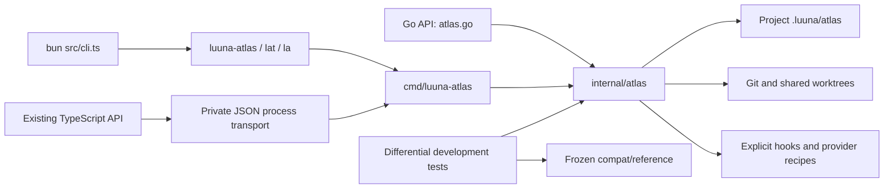

# Luuna Atlas Go rewrite

Atlas's CLI and library operations now run in Go. The baseline is commit `27477c313a3049b1579dfdc32c39da600726721f`, package version `0.11.0`. The rewrite preserves the existing project layout, record/config schemas, executable names, commands, flags, hooks, provider recipes and Luuna ownership boundaries. It introduces no data migration beyond the existing one-way legacy-layout migration.

The complete baseline behavior and surrounding system are mapped in [CLI-SYSTEM-MAP.md](CLI-SYSTEM-MAP.md); [CLI-REFERENCE.md](CLI-REFERENCE.md) contains the captured help. That map's former TypeScript module links now resolve to the frozen reference. This report describes the replacement implementation.

## Run and build

Development uses Go **1.27.0** and Bun **1.4.3**:

```sh
bun install --frozen-lockfile --ignore-scripts
bun run build:native
bun src/cli.ts --help
bun run verify
```

The build writes `.atlas-bin/luuna-atlas`, `.atlas-bin/lat` and `.atlas-bin/la` (`.exe` on Windows). Run any of these directly in the intended user project's root. The executable runs without Bun, Node, Go, the source checkout or the compatibility reference. Git-backed commands still require Git; configured shell hooks and external provider recipes still require their declared interpreters/tools.

The direct native build is:

```sh
go build -mod=vendor -trimpath -o luuna-atlas ./cmd/luuna-atlas
```

Go dependencies are vendored. Build tooling uses the local Go toolchain and disables module downloads. `LUUNA_ATLAS_GO` selects a Go executable outside PATH. `LUUNA_ATLAS_BINARY` selects an existing executable for the source/API transports. Source launchers build a host executable when the source digest changes, with a build lock, temporary output and cached digest. The digest includes the host OS/architecture; host builds explicitly select the host target.

The existing `bun src/cli.ts <args>` entry point forwards arguments, stdin, stdout, stderr and exit status to Go. Existing `src/index.ts` and `src/api.ts` exports retain their TypeScript signatures and call Go through a private process transport. Asynchronous APIs use asynchronous child processes; synchronous helpers remain synchronous. Reference identity and input-ID mutation behavior are retained in the facade. [atlas.go](atlas.go) provides a native Go library using the same implementation.

## Native architecture



| Layer | Current source | Responsibilities |
|---|---|---|
| Entry and parsing | [cmd/luuna-atlas/main.go](cmd/luuna-atlas/main.go), [cli.go](internal/atlas/cli.go), [app.go](internal/atlas/app.go), [help.go](internal/atlas/help.go) | Dispatch, global/command flags, choices, custom flags, help, version, suggestions, output streams and exit status |
| Captured public definitions | [contract.json](internal/atlas/contract.json) | CLI help/option definitions and public JSON schemas; embedded into the executable |
| Configuration and migration | [config.go](internal/atlas/config.go), [config_commands.go](internal/atlas/config_commands.go), [legacy_layout.go](internal/atlas/legacy_layout.go) | YAML, defaults, domain management, worktree store resolution and centralized legacy names |
| Records and validation | [model.go](internal/atlas/model.go), [registry.go](internal/atlas/registry.go), [schema.go](internal/atlas/schema.go), [store.go](internal/atlas/store.go) | Six built-ins, custom/inherited/disabled types, aliases, validation, IDs, JSONL, advisory locks and atomic replacement |
| Retrieval | [search.go](internal/atlas/search.go), [read_commands.go](internal/atlas/read_commands.go), [prime.go](internal/atlas/prime.go), [retention.go](internal/atlas/retention.go) | BM25, confirmation scores, filtering, trust, budgets, context selection, supersession, staleness and anchor decay |
| Git | [git.go](internal/atlas/git.go), [git_commands.go](internal/atlas/git_commands.go) | Changed files, commit evidence, active-work context, shared worktrees, learn, diff and sync |
| Presentation and integration | [format.go](internal/atlas/format.go), [format_color.go](internal/atlas/format_color.go), [setup.go](internal/atlas/setup.go), [hooks.go](internal/atlas/hooks.go) | Markdown/compact/XML/plain/JSON, terminal colors, setup recipes, shell hooks and provider integration |
| Programmatic access | [api.go](internal/atlas/api.go), [atlas.go](atlas.go), [src/api.ts](src/api.ts), [src/index.ts](src/index.ts) | Native operations and the existing public TypeScript facade |
| Development | [scripts/go-tool.ts](scripts/go-tool.ts), [scripts/verify-native.ts](scripts/verify-native.ts), [scripts/version-bump.ts](scripts/version-bump.ts), [CI](.github/workflows/ci.yml) | Pinned toolchain discovery, formatting/build/vet/tests and transactional version maintenance |

No production Go command delegates business logic to the reference. User-selected TypeScript/npm recipe extensions intentionally invoke Bun, preserving the existing extension interface. The production package file list excludes the reference and tests.

## Command coverage

Every row has a native implementation. The differential suites compare the Go CLI with the frozen original in disposable projects, including stdout/stderr, exit codes and persisted state. All root/command/config-child help is also compared.

| Command | Native implementation | Behavioral coverage |
|---|---|---|
| `init` | cli.go, config.go | Creation, repeat initialization, expected files and JSON |
| `add` | read_commands.go, config.go | Domain validation, existing domains, config/file writes |
| `record` | record.go | Every built-in, custom types, aliases, stdin/bulk, duplicates/upserts, quality, domain rules, hooks, dry run and malformed input |
| `edit` | edit.go | IDs/prefixes/indexes, type-specific/base fields, aliases, array updates and schema failures |
| `query` | read_commands.go | Domain/all, filters, formats, unknown types and empty results |
| `setup` | setup.go | Claude/Cursor/Codex round trips, built-in/custom recipes, npm conditional exports, shell/TS extensions and explicit Git hooks |
| `prime` | prime.go | All formats, manifest, records/full modes, budgets, trust/scope, anchors, Git/active work, hook mutation/blocking and export |
| `hook` | hooks_guard.go, hooks_inject.go | Provider event payloads, write guard, fail-open paths, injection/state and unknown-type forwarding |
| `onboard` | onboard.go | stdout, install, check, remove, markers and legacy markers |
| `status` | read_commands.go | Domain counts/order, dates, type mix, governance and shelf life |
| `validate` | health.go | Schema/domain rules, legacy warnings, unknown types, malformed JSON and non-object values |
| `prune` | prune.go | Dry run/hard/aggressive modes, retention, anchors, supersession, archive writes and hooks |
| `archive` | archive_commands.go | Single/bulk, reasons, prefixes, dry run and archive metadata |
| `restore` | archive_commands.go | Archive resolution, live-store restoration and metadata cleanup |
| `search` | read_commands.go, search.go | BM25/tokenization, filters, confirmation boost, formats and empty matches |
| `show` | read_commands.go | Multi-ID lookup, full records and missing/ambiguous IDs |
| `stale` | prime.go, retention.go | Evidence/anchor changes, missing paths, shelf life and supersession |
| `rank` | read_commands.go, search.go | Confirmation frequency, score ordering, filters and limits |
| `outcome` | outcome.go | List/append, typed outcomes, strict durations and preserved record metadata |
| `doctor` | doctor.go | All 17 check/fix categories, custom schemas, cycles, corrupt files and pre-fix summaries |
| `ready` | read_commands.go | Recency/limit/filter behavior and record/outcome entries |
| `sync` | git_commands.go | Validation gates, no-validate, commits, unrelated staged files, empty messages, errors and worktree skip |
| `delete` | delete.go | Single/bulk, prefixes/indexes, confirmations and dry run |
| `delete-domain` | delete.go | Force/dry run, config cleanup and expertise-file deletion |
| `move` | move.go | Cross-domain writes, retained ID/metadata, incoming references and dry run |
| `learn` | git_commands.go | Changed/untracked files, domain suggestions, missing stores and Git errors |
| `compact` | compact.go | Analyze, manual replacement, auto proposals/apply, token estimates, hooks and dry-run quirks |
| `config show/schema/set/unset` | config_commands.go | Dot paths, defaults, YAML values, schema validation, atomic locked writes and parent-global flags |
| `diff` | git_commands.go | Git-ref parsing, per-domain record changes and missing refs |
| `update` (hidden) | cli.go | Existing deprecation error and exit status |
| `upgrade` | cli.go | Existing unpublished-package refusal |
| `completions` | completions.go | Exact Bash/Zsh/Fish script output and compatibility aliases |
| `audit` | audit.go | Evidence/citation metrics, thresholds, per-domain overrides, active Missions/legacy index, ignores and suggestions |

Primary evidence is in [parity_test.go](internal/atlas/parity_test.go), [parser_parity_test.go](internal/atlas/parser_parity_test.go), [write_parity_test.go](internal/atlas/write_parity_test.go), [custom_parity_test.go](internal/atlas/custom_parity_test.go), [prime_git_parity_test.go](internal/atlas/prime_git_parity_test.go), [setup_parity_test.go](internal/atlas/setup_parity_test.go) and [color_parity_test.go](internal/atlas/color_parity_test.go). Native unit/integration tests additionally exercise real file locks, concurrent writes, deterministic IDs, schemas, migrations, YAML, worktrees and Git churn. Public facade identity/concurrency tests are in [native-api.test.ts](test/native-api.test.ts).

## Preserved boundaries and quirks

- Atlas still owns structured expertise; Missions owns tickets/plans; Beacon owns reusable prompts. Luuna retains runtime policy and approval enforcement.
- Project records remain under `.luuna/atlas/`; config keys and record schemas are unchanged. Legacy migration remains centralized and one-way. No live project store was initialized or migrated for this rewrite.
- The exact duplicate gate, named upsert semantics, partial bulk success, custom-type behavior, advisory governance, shared-worktree store and existing pruning/compaction quirks are retained.
- Global `--format` still shadows command-local choices. Consequently the advertised `ids` format remains rejected at the CLI boundary, matching the baseline.
- Completion output retains its existing alias/shell limitations. Hidden `update` and disabled self-upgrade retain their current behavior.
- `--version --json` retains the legacy `"runtime": "bun"` compatibility field. The executable implementation is Go; this field is preserved response data.
- Generated timestamps and temporary project paths vary between executions and are normalized in differential checks. Machine JSON is compared structurally; dedicated record/maintenance fixtures additionally compare literal JSON/JSONL property order. Text and forced-color fixtures compare actual bytes. Hook-failure fixtures silence nondeterministic process-log headers while checking CLI errors, warnings and data effects. Source-specific uncaught Bun stack frames are replaced by native diagnostics; the full underlying error message, failure status and data effects remain checked. Ordinary handled errors retain their output contracts.
- Original internal Bun tests explicitly target the frozen reference. They establish the baseline; their pass count alone does not prove native correctness. Current CLI subprocess tests, public API tests and native/differential Go tests supply native evidence.

## Verification

`bun run verify` **exited 0** on the completed Windows checkout using Go **1.27.0** and Bun **1.4.3**. Frozen, script-free dependency installation also passed without dependency changes.

| Supported stage | Final result |
|---|---|
| Go formatting | Passed |
| Native executable and alias build | Passed |
| `go vet -mod=vendor ./...` | Passed |
| Native/differential Go tests | **107 top-level tests, 627 total cases passed; 0 skipped**, 405.800 seconds |
| TypeScript type check | Passed |
| Repository instruction check | Passed |
| Bun compatibility/reference suite | **1,605 passed, 3 skipped, 0 failed**, 4,255 assertions, 1,608 tests across 88 files, 330.26 seconds |

The three Bun skips are Windows executable-bit verification, the inherited forked-background-hook timeout case, and symlink-lock behavior. They are preserved platform exclusions; native hook-timeout and real-file concurrency tests also run in Go. Race detection and hosted CI remain separately unexecuted as described below.

The native verifier and `go:test` commands now run packages serially with verbose test output (`-p=1 -v`). Go's multi-package output buffering previously obscured progress while the integration suite was running; the final supported run streams individual results and completes successfully. Go can also perform synchronous test-cache work after printing a package pass, so the command's exit status is the completion gate. No verification failure is left pending.

The checkout's Windows amd64 executable is **7,865,344 bytes**, SHA-256 `ebf5fd569d5e4c867ece88624ccbbaf6d18b7fcd8825437e8216992948c83647`. `luuna-atlas.exe`, `lat.exe` and `la.exe` have this same hash and each reports version `0.11.0`.

Additional executed checks:

- Windows amd64 standalone binary: copied outside the checkout, then init → record → query with an empty PATH. The permanent native test builds and checks this behavior.
- Linux amd64 standalone binary: init → add → record → query executed in Ubuntu WSL with an empty PATH.
- CGO-disabled cross-builds: Windows amd64/arm64, Linux amd64/arm64 and macOS amd64/arm64, with target metadata inspected. Cross-compilation is not execution proof for macOS or ARM.
- Terminal formatting: actual forced-color bytes compared against Chalk at levels 0/1/2/3, plus command/help output and NO_COLOR help behavior.
- Version maintenance: temporary-file tests check complete version updates and rollback; no version bump was applied to this checkout.
- The frozen oracle's 83 source/package files were compared with the original Git commit with no content differences after normalizing checkout line endings. Its integrity manifest is checked by tests.
- Unicode normalization was compared with Bun for 1,498 changed-case characters plus contextual/combining cases. The Go implementation uses vendored [full Unicode case mapping](https://pkg.go.dev/golang.org/x/text/cases); YAML merge/duplicate behavior has native and differential regression coverage.

Final cross-build artifacts use `-mod=vendor -trimpath -ldflags '-s -w'` with CGO disabled. The checkout's `.atlas-bin/` build retains debug/symbol information, so its size and hash differ from the stripped cross-build artifacts. All three checkout executable aliases are byte-identical and report `0.11.0`.

| Final target | Build | Runtime verification | Stripped SHA-256 |
|---|---|---|---|
| Windows amd64 | Passed | Empty-PATH init/record/query | `26468f9cc262de814c913331599c1d4a84c2cd3f53498398918d3721e82e9524` |
| Windows arm64 | Passed | Compilation only | `930841a59a0fda23d62d41e58ac935f7bde884f02297fdcc6a44b5137f228431` |
| Linux amd64 | Passed | Empty-PATH init/record/query in Ubuntu WSL | `5481d5a71d92b177244efb3798bc3eaf16540e7c48ca3a92af614dba511ad960` |
| Linux arm64 | Passed | Compilation only | `469338ef77147e0c61399ace63eacbc033a8adaf2dc0248eaa3d7001559779b5` |
| macOS amd64 | Passed | Compilation only | `3da9cede391ffe118f29c91d022938cc55eea796936b5f1e00cc4ab0bf68a85d` |
| macOS arm64 | Passed | Compilation only | `64f952ec6b7ec6d6097c1a6ac0f64a59bee0e89c89abf12003451653d37b937d` |

Race detection needs a compatible C compiler for the Go host toolchain; this Windows toolchain has CGO disabled. Native concurrency tests run regardless. Hosted CI is configured for Windows and Linux; no hosted CI result is claimed from local execution.

Rewrite verification performed no commit, push, registry release, issue creation, root Git-hook change, sibling repository modification or Luuna component-pin update. A subsequent explicit user request authorizes committing and pushing this repository's completed work on `feat/go-cli-rewrite`. Registry release, merging and consumer-pin updates remain separate operations. The main Luuna runtime must consume a separately reviewed commit through its existing exact-commit process.
